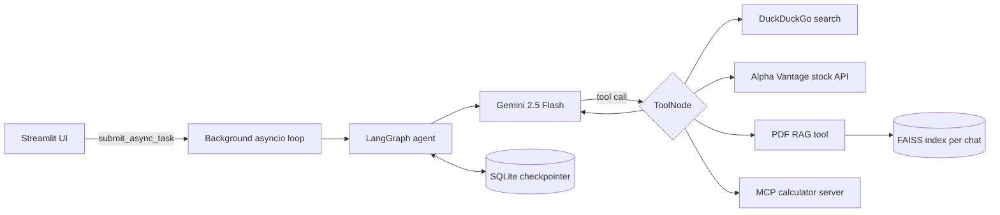

# Zarvis: Async Agentic AI Chatbot

Zarvis is an async, tool-using AI assistant built with **LangGraph** and **Gemini 2.5 Flash**. The agent decides on its own when to search the web, fetch live stock prices, do calculations through an **MCP (Model Context Protocol)** server, or answer questions from a PDF you attach to the chat. Conversations are saved, so you can close the app and pick up where you left off.


## Features

- **Agentic tool use:** a LangGraph agent loop where the model chooses tools, reads the results and decides the next step.
- **MCP calculator:** arithmetic and percentage tools served by a separate MCP server over stdio and loaded dynamically at startup.
- **PDF chat (RAG):** attach a PDF in the chat box and ask questions about it. Each conversation gets its own FAISS index, saved to disk.
- **Live web search and stock prices:** DuckDuckGo search and the Alpha Vantage API, with async HTTP calls.
- **Persistent multi-chat history:** conversations are stored with LangGraph's async SQLite checkpointer. Sidebar titles come from the first message, and a page refresh reopens the same chat.
- **Streaming responses:** tokens stream into the UI, with a live status line while a tool runs.
- **Fully async backend:** one background event loop serves the graph, the database and the MCP client.
- **Custom Streamlit UI:** dark theme, a minimal chat layout and an in-input attachment button.

## Architecture



**How a request flows**
1. The Streamlit UI sends the message to a background asyncio loop, so the sync UI never blocks the async backend.
2. The graph sends the conversation to Gemini. If the model requests a tool, the `ToolNode` runs it and sends the result back to the model.
3. The loop ends when the model answers without a tool call. Tokens stream back to the UI as they are produced.
4. After every step the checkpointer saves state under the chat's thread id, which gives persistent memory and the conversation list.

## Tech stack

| Area | Tools |
|---|---|
| Agent framework | LangGraph, LangChain |
| LLM | Gemini 2.5 Flash (`langchain-google-genai`) |
| Tools protocol | MCP (`langchain-mcp-adapters`, FastMCP) |
| RAG | PyPDF, `sentence-transformers/all-MiniLM-L6-v2`, FAISS |
| Persistence | SQLite via `AsyncSqliteSaver` (`aiosqlite`) |
| Async I/O | `asyncio`, `httpx` |
| Frontend | Streamlit |

## Project structure

```
.
├── chatbot_ui.py          # Streamlit interface (chat, sidebar, attachments)
├── chatbot_async_mcp.py   # LangGraph agent, tools, checkpointer, async loop
├── rag_engine.py          # PDF ingestion, per-chat FAISS index, rag_tool
├── calculator_server.py   # MCP server exposing calculator tools
├── requirements.txt
├── .env.example
└── .streamlit/config.toml # Theme and server settings
```

## Getting started

**Requirements:** Python 3.11 or newer, and a [Gemini API key](https://aistudio.google.com/apikey).

```bash
# 1. Clone and enter the project
git clone https://github.com/theshivadwivedi/Zarvis-Async-Agentic-AI-Chatbot.git
cd Zarvis-Async-Agentic-AI-Chatbot

# 2. Create a virtual environment
python -m venv venv
venv\Scripts\activate          # Windows
# source venv/bin/activate     # macOS / Linux

# 3. Install dependencies
pip install -r requirements.txt

# 4. Add your keys
copy .env.example .env         # Windows
# cp .env.example .env         # macOS / Linux

# 5. Run
streamlit run chatbot_ui.py
```

The app opens at `http://localhost:8501`. The first start takes longer because the embedding model downloads once.

### Environment variables

| Variable | Required | Purpose |
|---|---|---|
| `GOOGLE_API_KEY` | Yes | Gemini API access |
| `ALPHAVANTAGE_API_KEY` | Optional | Enables the stock price tool (free key at alphavantage.co) |
| `HUGGING_FACE_HUB_TOKEN` | Optional | Faster model downloads |
| `LANGSMITH_API_KEY`, `LANGCHAIN_TRACING_V2` | Optional | LangSmith tracing |

## Usage

- **Web search:** "What are the latest AI news today?"
- **Stock price:** "What is the current price of AAPL?"
- **Calculator (MCP):** "What is 18% of 2450?"
- **PDF chat:** click **+** in the chat box, attach a PDF, then ask "Summarize this document".
- **History:** previous chats appear under **Recents** in the sidebar.

## Design decisions

- **Background event loop:** Streamlit reruns scripts synchronously, while the MCP client and `AsyncSqliteSaver` need a persistent event loop. A dedicated loop thread connects the two cleanly.
- **Per-chat vector indexes:** each conversation has its own FAISS folder, so documents never leak between chats and indexes survive restarts.
- **Thread id from config:** `rag_tool` reads the chat id from the runnable config, which is more reliable than asking the model to pass it.
- **Graceful degradation:** if the MCP server fails to start, the app continues with the remaining tools.
- **Secrets in the environment:** API keys are read from `.env`, never hardcoded.

## Limitations and roadmap

- Chat history lives in a local SQLite file, so it is meant for single-user use. A multi-user deployment needs per-user chat filtering and a hosted database such as PostgreSQL.
- On hosts with a temporary disk, history and indexes reset when the app restarts. Use a persistent disk or an external database.
- Scanned (image-only) PDFs are not supported because there is no OCR step.
- Planned: Docker setup, user authentication, and a hosted vector store.

## Author

Built by Shiva ([@theshivadwivedi](https://github.com/theshivadwivedi)).
